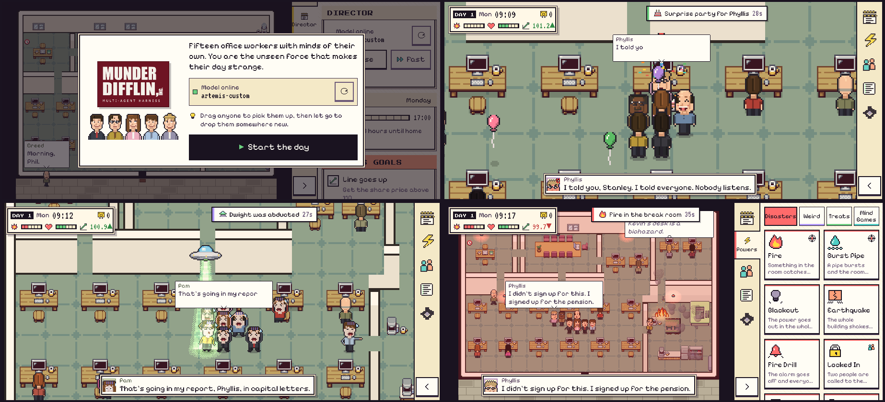

# Munder Difflin: the living office

A pixel-art office whose fifteen staff think for themselves, and you are the unseen force that
makes things happen to them. Played on a phone held sideways (it also works in a desktop browser
and in the Electron app).



Every worker is played by **your own local model through [Ollama](https://ollama.com/)**
(default: `artemis-custom`). No cloud, no API key. The model writes what each person says, what
they feel, what they decide to do next, and how they feel about each other afterwards.

## What you do

You are the **Overseer**. The staff do not know you exist.

- **Powers**: 34 events in four groups.
  - *Disasters*: fire, burst pipe, blackout, earthquake, fire drill, locked in, Wi-Fi down, snack storm.
  - *Weird*: abduction, haunting, zero gravity, time freeze, smite, shrink ray, embiggen, body swap, disco fever, bees, raccoon.
  - *Treats*: pizza party, office puppy, bonus rain, surprise party, triple espresso.
  - *Mind games*: Cupid's arrow, grudge, truth serum, nap attack, paranoia, layoff rumour, all-hands, inspection, boss for a day, leak a secret.
- **Whisper** a thought into one person's head. They think it is their own idea, and it sticks for
  the rest of the day: every minute or so they act on it (go and have it out with whoever it names,
  tell someone else, take over the boss's office), they keep bringing it up, and their card in
  People shows what they are sure of and since when.
- **Announce** something over the loudspeaker to everyone.
- **Anything**: type any event at all ("a horse walks into the office"). The model works out what it is
  and it stays for a few minutes. A character ("Superman enters the office") becomes a person on the
  floor who talks, walks up to people one by one, and leaves by the front door; a creature wanders
  about and goes up to people; a thing stays where it appeared. It can set off a real event (a dragon
  starts a fire), people who saw it make plans about it, and afterwards the ones it met talk it over.
- **Pick people up**: press on someone, then drag. Let go to drop them, or fling them.
- **Tap** someone to see their mood, what they are thinking, who they like and dislike, what they remember, and (once it comes out) their secret.

The staff remember what happens, hold grudges, form plans and act on them. Each office day runs
09:00 to 17:00 and ends with a written report. The world saves itself in the browser: grudges,
memories, the share price and the day number carry over. If you close the game part-way through a
day, that day starts again from the morning.

### Story: Closing Time

Choose **Play the story** on the title screen (or **Sandbox** for free play). Corporate is closing one
of its branches on Friday, and this one is on the list. Each weekday is a chapter with one main job and
two extra goals. The chapter card opens with what happened before, then the day's goal and its clues.
If you lose or retry a day, the card also shows "Stuck? Ways that work".

| Day | Chapter | The job | What is in the way |
|---|---|---|---|
| Monday | The Memo | Get Michael and at least 9 others into the conference room between 14:00 and 15:00 for Corporate's call. | Michael really hides in his office and ignores the loudspeaker; at 10:20 Creed goes through his bin. |
| Tuesday | Not Speaking | Three good talks between Angela and Oscar (or both back to liking each other) before five. Each talk shows its count. | Dwight keeps warning Angela about Oscar, and after lunch Kevin starts worrying Oscar. |
| Wednesday | The Client | Get Mr Figgis and a salesperson together in a meeting room before his patience runs out. | Michael keeps barging in to pitch, and not every salesperson suits him: read his card. |
| Thursday | The Leak | Work out who is faxing Corporate and accuse them (two tries). | Everyone on an errand uses the same fax machine; only the leak's pages make it beep. |
| Friday | The Verdict | Pass the inspector's tour. | Michael wants to give a farewell speech, and the week's loose ends turn up on the tour. |

Two numbers run the week:

- **Influence** is today's budget (6 to 10). Powers cost 2 to 4; whispers, announcements and "tell them to"
  cost 1; Anything costs 3. Picking people up and poking are free. An extra goal gives 2 back.
- **Branch Standing** starts at 40. A won day adds 8 and a lost one takes 8, each extra goal adds 2,
  incidents take 1 each (at most 3 a day), and morale moves it by 1. The report lists every change and why.
  After Friday: 75 or more **and** a passed inspection keeps the branch open, under 45 closes it, and
  anything else survives with cuts.

Days remember each other: a late set of accounts makes Mr Figgis start out annoyed, the Figgis order makes
Thursday's fax quieter, and an uncaught leak tries one last page during Friday's tour. The week ends with a
scene on the floor before the ending card.

While you play:

- Story moments show as a caption at the bottom of the floor, and a stamp marks each goal won or lost.
- The day's key people carry a name tag while the camera is zoomed out.
- When nothing needs you for a while, the mission row offers a time, such as **10:25**: one tap skips ahead to it.
  Once the day's job is settled, **Finish the day** runs the rest quickly to the report, and after a loss
  **Try the day again** starts the same morning over.
- The fast-forward button on the rail switches between normal speed and 2x. Tap the clock to pause; the day
  also pauses while you type.
- Whisper suggestions fit the person you are whispering to. The ones that give a day's answer away only appear
  after you have failed that day once, next to "Stuck? Ways that work" on the card.
- In the story, a whisper or an order is read by its plain words. With the model online, the words and the
  model must agree before anyone is hurt, quits or is locked away, so an innocent sentence cannot wreck a day.
  A mild order stays mild ("follow Jim" is never an attack), and nobody is removed for the day unless the
  words say so ("punch Jim" is never an elimination). A deliberate order ("quit your job") still works.

The story saves itself separately from the sandbox. Announcements that name a room send people there, and
people you drop stay put for a while: both work in the sandbox too.

### Episode 3: Inside Job

A caper in the ordinary office, Wednesday to Friday. Michael posted Corporate the wrong tape for its "Why
Scranton" video: the one where he practises firing the vice president. Ms Vane from Corporate keeps it in a
locked briefcase in the conference room, and on Friday at two the vice president watches it by video link.
A short opening scene plays first (skippable). The number to watch is **Cover**, which starts at 40 and moves
like Branch Standing.

| Day | Chapter | The job | How it works |
|---|---|---|---|
| Wednesday | The Combination | Learn the lock's three numbers before five. | Ms Vane opens the case at about 10:15 (break room), 11:45 (conference room), 13:30 (copier in the annex) and 15:00 (Michael's office). Exactly one person standing close to her sees a number; two or more and she turns her back; the same person twice is "caught hovering". Michael never counts. Truth Serum on her makes her read the next number out loud. |
| Thursday | The Switch | Swap the tapes before five. | Michael starts with the right tape. Drop someone beside the holder (or whisper to them to take the tape) to pass it on. She leaves the room at about 10:30, 12:30 and 14:30; the holder must stand beside the case, with at most one other person in the room, for 10 seconds with the code or 26 without (Dwight and Creed are quicker, Kevin and Michael slower, espresso helps). Someone you put next to her when she turns back keeps her talking 13 seconds more. Caught at it twice and the case goes to her hotel. Extra: take the wrong tape into the annex to shred it. |
| Friday | The Screening | The right tape plays at 14:00 and no more than one person talks. | She questions five people (09:45, 10:45, 11:45, 12:45, 13:20, Michael last); the Log names each a few minutes ahead. Nervous, scared, sad or grumpy people talk, and so do weak nerves unless whispered to or in a good mood. Carry the one she wants away and she settles for whoever is nearest her. If Thursday failed, the switch is still possible while she is out questioning. |

After Friday: the wrong tape playing ends the job badly whatever the Cover. The right tape with at most one
talker is a clean getaway with Cover 60 or more and a near thing below that. The right tape with two or more
talkers is a near thing with Cover 40 or more and the whole story out below that. The tuning numbers sit at
the top of each day in `story/heistChapters.ts`; all the words are in `story/heistText.ts`.

### Touch controls

| Gesture | What it does |
|---|---|
| Drag empty floor | Pan |
| Pinch | Zoom |
| Double tap | Zoom in on that spot, or back out |
| Tap a person | Select and follow them |
| Press a person, then drag | Pick them up; release to drop or fling |

## Playing on your phone

The page has to be able to reach the laptop that runs Ollama. There are two good ways.

### A. Serve it from the laptop (simplest at home)

On the laptop that runs Ollama:

```bash
npm install --ignore-scripts
```

```bash
npm run build:web
```

```bash
npm run serve
```

It prints addresses such as `http://MSI.local:8787`. Open one on your phone (same Wi-Fi), turn the
phone sideways, and press **Start the day**. This small server hands out the game and forwards
model requests to Ollama on the same machine, so there is nothing to configure in Ollama and no
browser security settings to fight. Options: `--port 8787`, `--ollama http://127.0.0.1:11434`.

The first time, Windows may ask whether to let Node through the firewall: allow it on private
networks. Away from home, with Tailscale running on the phone, the same server answers at
`http://<the laptop's Tailscale name>:8787`.

### B. Hosted page plus Tailscale (works away from home)

Deploy the web build anywhere static (the repo's `vercel.json` already builds it for Vercel:
`npm run build:web`, output `dist-web`). Because a hosted page is `https`, the model address must be
`https` too: use the laptop's Tailscale Serve address (the default in Settings is
`https://msi.tail780d1f.ts.net`). Ollama must allow the page's origin:

```bash
OLLAMA_ORIGINS=https://your-app.vercel.app ollama serve
```

The phone must be on the tailnet, and Tailscale must be signed in on the laptop.

### D. As an Android app

`npm run build:android` makes `dist-android/munder-difflin.apk`: the same game in a full-screen,
landscape app with its own icon. It keeps the screen on, leaves the game running when you press
Back, and buzzes on drops. On first run it looks for Ollama at `http://MSI.lan:11434`, then
`http://192.168.1.124:11434` (change the list with `--ollama a,b`), so it works on the home Wi-Fi
with nothing changed on the laptop. Install it from the computer the phone is connected to:

```bash
adb install -r munder-difflin.apk
```

or open the file on the phone and allow installing from that app. To see what the game logs, run
`adb logcat -s MunderDifflin`; `chrome://inspect` on the computer can look inside it too. Building
needs Java and Android's build tools (`aapt`, `d8` or `dx`, `zipalign`, `apksigner`, a platform
`android.jar`); the top of `tools/build-apk.mjs` says where it finds them. The first build makes a
signing key at `android/debug.keystore` (not committed). Keep it: an app signed with a different key
has to be uninstalled before the new one goes on, and that deletes the save.

### C. A preview inside Claude

The same build can be published as a Claude Artifact, which is a quick way to look at the game on
a phone without setting anything up. A page inside Claude cannot reach a model server, so there
the staff run on the written lines, and Claude itself writes only what follows from your own
actions (a whisper, an announcement, a typed event, the day's report). It asks your permission the
first time. To publish a new one: `npm run build:web`, then publish a page that loads
`assets/index-*.css` and `assets/index-*.js` from `dist-web` with the `sample` capability.

### If it says the model is offline

The game keeps running: the staff fall back to hand-written lines ("instinct") until the model
answers, and it retries by itself every 20 seconds. Open **Settings > Brain**, check the address
and model, and press **Test**: the message says what is wrong in plain words.

A 16 GB model can take up to a minute to load the first time it is asked something.

### If the lines come out wrong

- **People talk out of character, or ignore who they are.** The model is probably reading only the
  end of the prompt. Each request is about 2,000 tokens (the day's report about 2,800), so the model
  needs a context window of 4,096 or more. Current Ollama defaults to that; older versions default
  to 2,048. Check with `ollama show artemis-custom`, and if needed add `PARAMETER num_ctx 4096` to
  its Modelfile and rebuild it. The game never sends this setting itself, because that would make
  Ollama reload the model.
- **Long silences before anyone speaks.** The first request has to read the whole cast (about
  1,600 tokens). After that only the new part is read, as long as nothing else uses the model in
  between. Another program talking to the same model throws that saved work away each time, and a
  game running on the laptop's GPU at the same time makes every answer many times slower.
- **Odd symbols or half sentences.** The game already repairs or drops broken replies and retries
  once. If it happens a lot, lower **Wildness** in Settings > Brain.

## Development

```bash
npm run dev:web
```

runs the web game at `http://localhost:5173`.

```bash
npm run mock-llm
```

runs a stand-in for Ollama on port 11500 that answers in the right format at 7 tokens a second
(point Settings > Brain at `http://localhost:11500`). It prints how much text each request sent,
and it has deliberately broken "models" for testing how the game copes.

```bash
npm test
```

runs the logic tests (map, simulation, brain, written lines).

`npm run dev` still runs the Electron build.

## How it is put together

| Piece | Where | Role |
|---|---|---|
| Map, rooms, desks | `src/renderer/src/game/core/world.ts` | The existing Tiled map as logic: walkable tiles, rooms, named spots, paths. |
| The fifteen people | `src/renderer/src/game/core/cast.ts` | Personas, temperaments, voices, how they feel about each other on day one. |
| Powers | `src/renderer/src/game/core/chaos.ts`, `game/sim/chaos/` | The catalogue, and one script per event. |
| Simulation | `src/renderer/src/game/sim/` | Headless and deterministic: movement, routines, the working day, being picked up, memory, relationships, meters, saving. |
| Brain | `src/renderer/src/game/brain/` | Ollama / OpenAI-compatible / Claude transports with streaming, prompts, tolerant parsing, the instinct fallback, health tracking. |
| Director | `src/renderer/src/game/director/` | Decides when the model is asked for something and plays what it writes on the floor. |
| Floor | `src/renderer/src/scene/office/floor/`, `actor/`, `fx/` | The original map renderer plus expressive sprites, pixel effects, and a touch camera. |
| Interface | `src/renderer/src/components/game/` | The phone-landscape UI in the original cream pixel style. |
| Sound | `src/renderer/src/game/audio/` | Everything synthesized at runtime: effects, each person's talking blips, adaptive music. |
| Story | `src/renderer/src/game/story/` | The five chapters, influence and standing, saving and retrying a day. |
| Game | `src/renderer/src/game/game.ts` | Wires all of the above together behind one `GameApi`. |

### How the model is used at 7 tokens a second

- One request at a time. A **scene** (a few lines between people who are together) streams, so the
  first line is spoken while the rest is still being written.
- The long, unchanging part of every prompt (the setting, the fifteen people, the rules) is
  identical between calls, so Ollama reuses it and only reads the new part.
- Replies are constrained to a JSON shape and capped in length. Anything unusable is retried once,
  then answered from the written fallback, so the game never stalls.
- Reflexes ("FIRE!") come from hand-written lines at once; the model's fuller reaction follows a
  few seconds later.
- When nothing else is happening, the director starts small talk between two people who are free,
  about something recent, how they feel about each other, or the time of day. Whoever has been
  quiet longest goes first, and the same two do not talk twice in a row.
- A slow model spends its time on dialogue. Rounds of private thoughts and plans happen about once
  every minute and a half instead of every half minute, and people go back to work as soon as the
  last line is spoken rather than waiting for the summary to finish.

In a test against a stand-in server at 7 tokens a second, the first conversation started about
20 seconds into the day and a new three-line conversation followed roughly every 25 to 30 seconds,
with hand-written thought bubbles and reactions in between.

## Notes

- The characters and office are a parody of a well-known TV comedy, and the tile art is LimeZu's
  free pack, which is licensed for non-commercial use only (`src/renderer/src/assets/ATTRIBUTION.md`).
  Fine for a personal project; both would need replacing before any commercial release.
